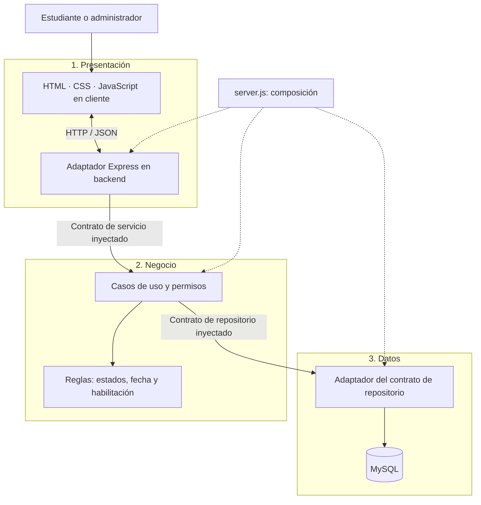
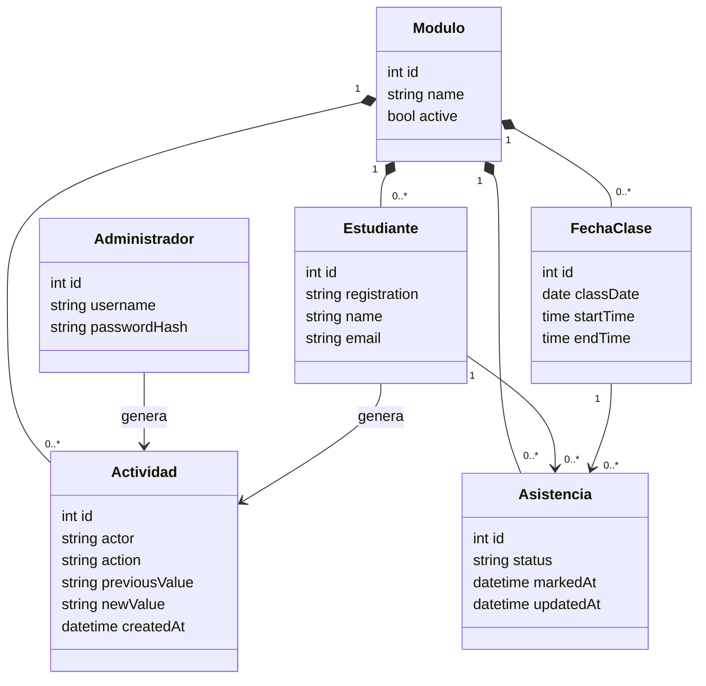
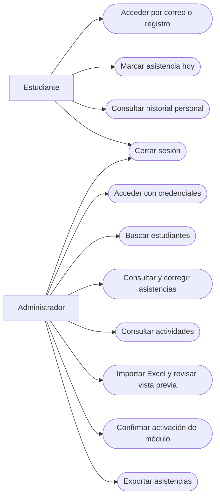
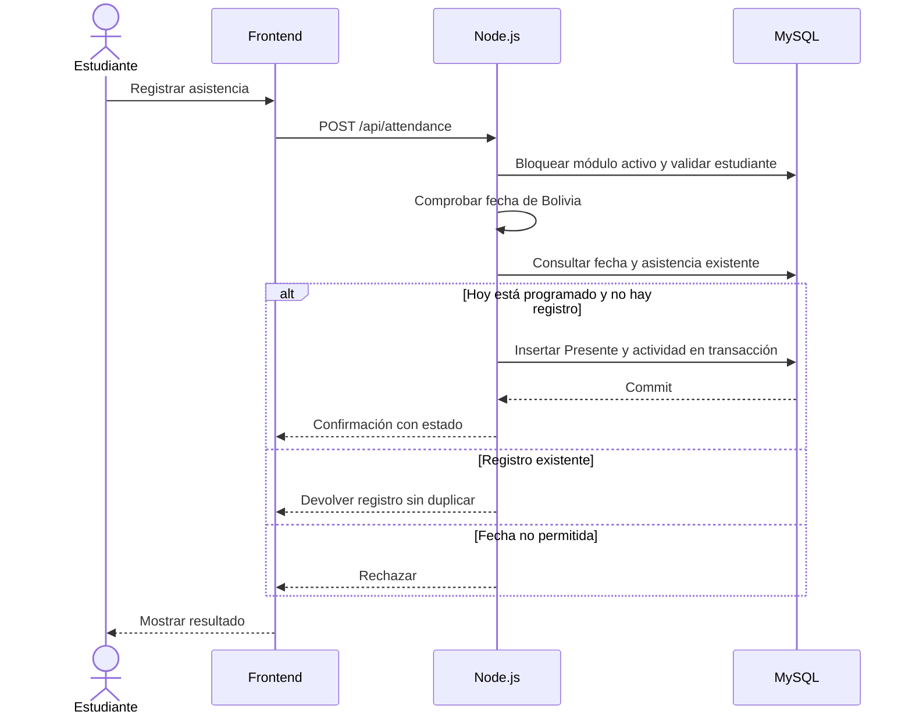
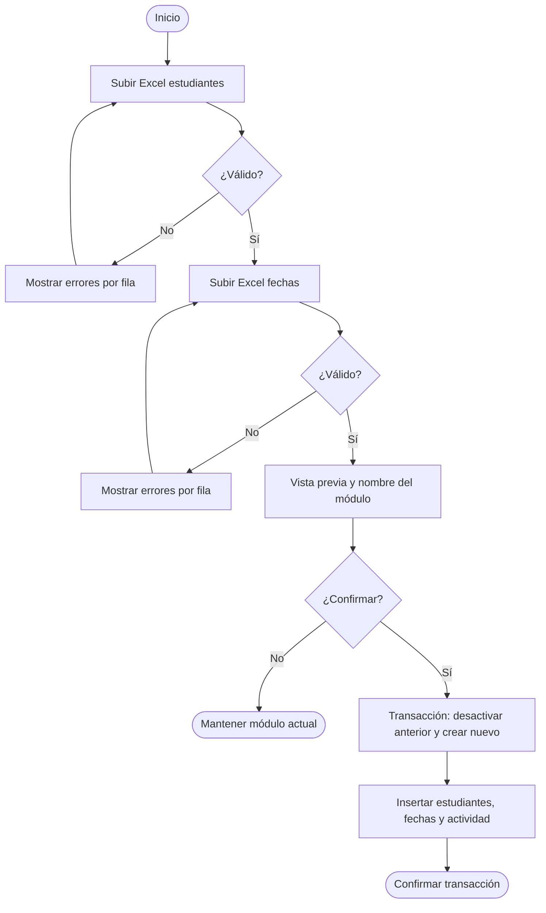
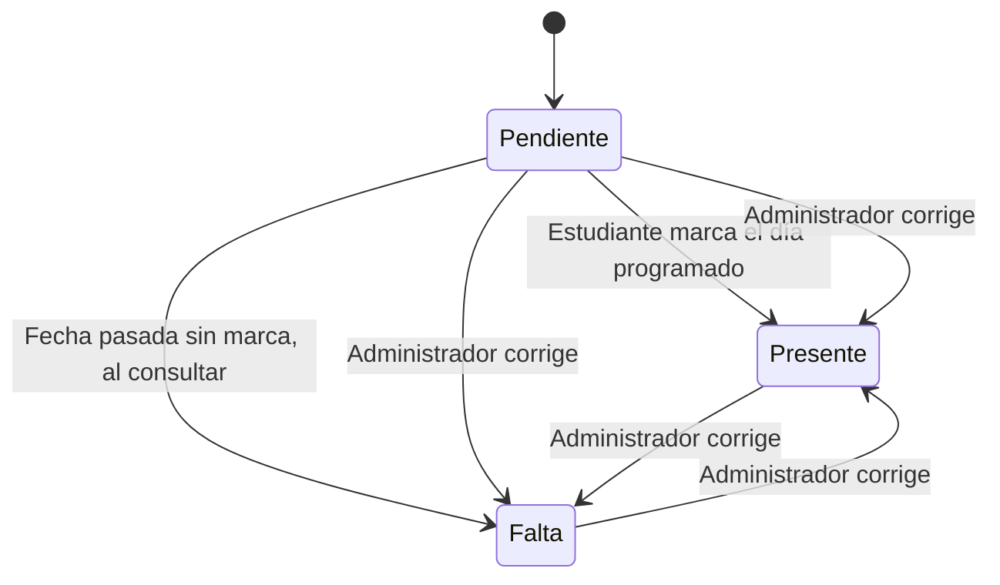
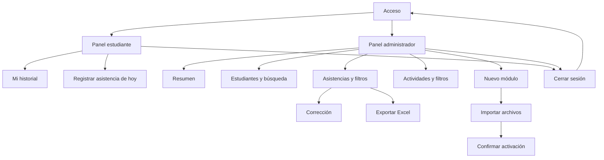
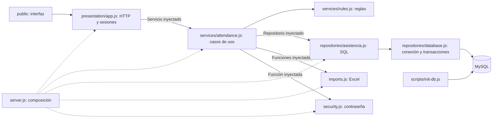
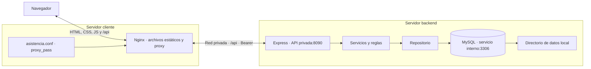

# Diseño y diagramas

Fuente principal: `Requerimientos_Control_Asistencia.pdf`, RF-01 a RF-15. Complementos: Node.js, MySQL, tres capas, diseño responsivo azul y rojo, ejecución local. Se implementan además vista previa, exportación y mensajes (RF-16 a RF-18).

## Arquitectura de tres capas



Las flechas entre capas representan llamadas por contrato. Negocio no importa el adaptador MySQL y presentación no importa repositorios. Los estados y permisos pertenecen a negocio. Ver `arquitectura.md` para los contratos y la trazabilidad con RF/RN.

## Clases



Restricciones: módulo activo único; registro único por módulo; asistencia única por estudiante/fecha; claves compuestas impiden mezclar estudiantes y fechas de distintos módulos.

## Casos de uso (representación equivalente)



## Secuencia de marcación



## Secuencia de corrección

```mermaid
sequenceDiagram
 actor A as Administrador
 participant P as Frontend
 participant N as Node.js
 participant D as MySQL
 A->>P: Seleccionar Presente o Falta
 P->>N: PUT /api/attendance
 N->>N: Verificar sesión y rol
 N->>D: Bloquear módulo activo
 N->>D: Validar estudiante y fecha del módulo
 N->>D: Consultar valor anterior
 N->>D: Actualizar estado y registrar actividad
 Note over N,D: Misma transacción; conserva hora de marca original
 D-->>N: Commit
 N-->>P: Resultado
 P-->>A: Estado actualizado
```

## Actividades de importación



## Estados de asistencia



Pendiente es un estado visual, no un registro de asistencia almacenado. Falta puede ser derivada o una corrección explícita. Una corrección existente no es reemplazada por una marca estudiantil.

## Navegación



## Componentes



## Despliegue del cliente y backend



Instalación manual con Nginx como servicio en el cliente, y Node.js/systemd más MySQL como servicios en el backend. MySQL escucha solo en `127.0.0.1`. La URL pública del cliente se autoriza con `FRONTEND_ORIGINS`; `TRUSTED_PROXIES` identifica el Nginx de confianza. El navegador usa `/api` en su mismo origen y nunca accede directamente a MySQL. Ver `README.md` para despliegue nativo y HTTPS.

## Trazabilidad

| Requisitos | Implementación |
|---|---|
| RF-01, RF-02 | Acceso estudiante/admin, sesión Bearer, cierre de sesión y autorización |
| RF-03, RN-03, RN-04 | `mark`, fecha institucional, restricción única en MySQL |
| RF-04, RF-05 | Historial, Falta derivada al pasar la fecha, resumen personal |
| RF-06, RF-08 | Búsqueda, filtros, totales y listas administrativas |
| RF-07, RF-09, RF-10 | Correcciones y auditoría transaccional, consulta filtrada |
| RF-11, RF-12 | Validación de Excel completa antes de preparar datos |
| RF-13, RF-15 | Confirmación y activación transaccional sin borrar módulos anteriores |
| RF-14 | MySQL, claves foráneas y restricciones |
| RF-16 a RF-18 | Vista previa, exportación y mensajes |

No se implementa consulta histórica de módulos, múltiples módulos activos, QR, geolocalización, reconocimiento facial, notificaciones o atrasos.
